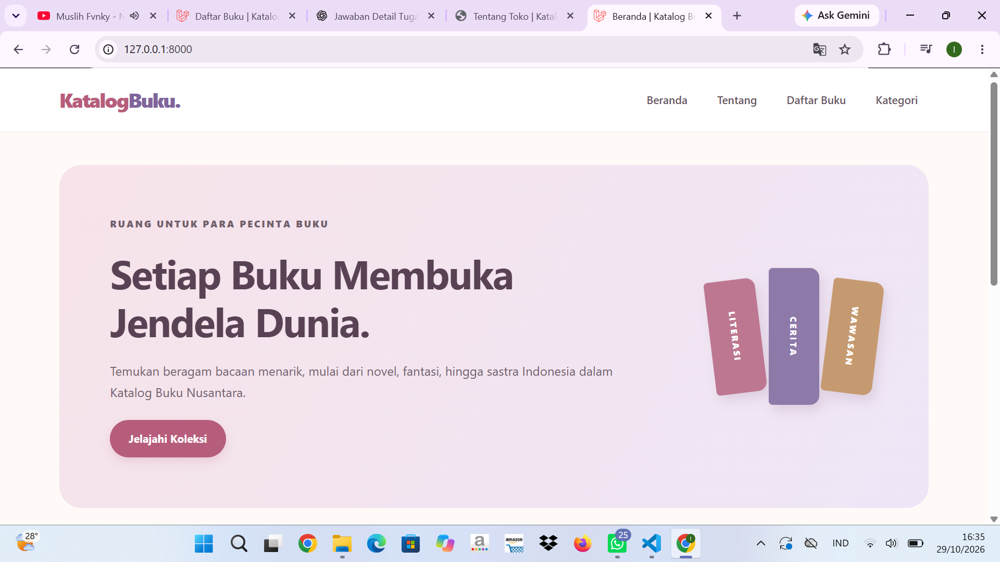
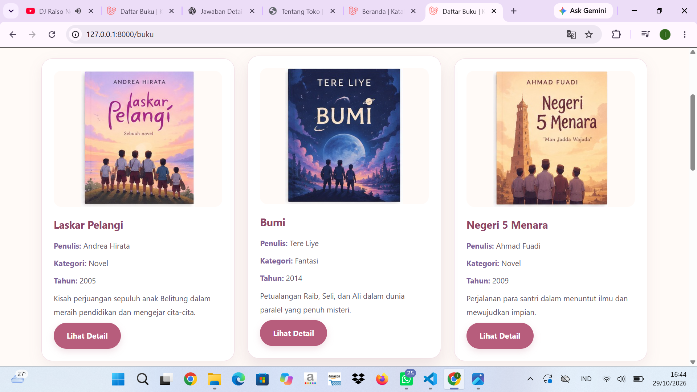
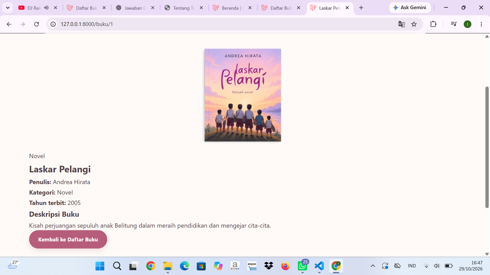

# Katalog Buku Nusantara

## Identitas Mahasiswa
- **Nama:** Lina Lestari
- **NIM:** C2483207030
- **Kelas:** PTI/5
- **Mata Kuliah:** Praktikum Pemrograman Internet

## Deskripsi Proyek
Katalog Buku Nusantara merupakan website sederhana yang dibuat menggunakan Laravel. Website ini membantu pengunjung melihat koleksi buku, membaca informasi kategori, dan melihat detail setiap buku.

## Fitur Website
- Halaman Beranda
- Halaman Tentang
- Daftar buku beserta gambar sampul
- Halaman kategori buku
- Halaman detail buku berdasarkan ID
- Navigasi antarhalaman

## Penerapan Konsep MVC

### 1. Routing
Routing digunakan untuk mengatur alamat halaman website dan menghubungkannya dengan metode Controller yang sesuai.

### 2. Controller
Controller mengatur data dan menentukan halaman yang akan ditampilkan. Data buku disimpan dalam array PHP pada `BukuController`.

### 3. View
View menggunakan Blade untuk menampilkan data buku, kategori, dan detail buku kepada pengunjung.

## Teknologi
- PHP
- Laravel
- HTML
- CSS
- Blade Template

## Cara Menjalankan Website
1. Pastikan PHP dan Composer sudah terpasang.
2. Buka terminal di folder proyek.
3. Jalankan `composer install` jika dependensi belum tersedia.
4. Jalankan `php artisan serve`.
5. Buka `http://127.0.0.1:8000` di browser.

## Screenshot Website
## Screenshot Website

### Halaman Beranda

### Halaman Daftar Buku

### Halaman Detail Buku

